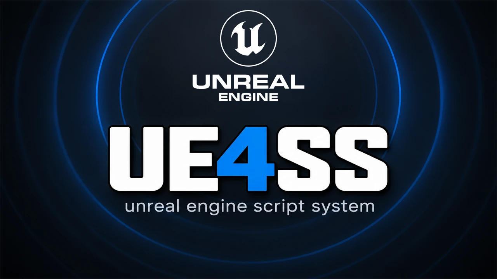

# UE4SS

The official [RE-UE4SS](https://github.com/UE4SS-RE/RE-UE4SS) script loader with one ready zip per Unreal game: UE4SS
plus that game's config.

## What it does

UE4SS (Unreal Engine 4/5 Scripting System) loads Lua and C++ mods into Unreal Engine games while they run. Many mods
need it. This listing republishes official UE4SS builds, so they can be found on openmods:

- UE4SS `v4.0.0`: the official release of 2026-11-12 (commit
  [`30afe5ff`](https://github.com/UE4SS-RE/RE-UE4SS/commit/30afe5fff94a94c2313e220b2002059a080da9a0)), for Phantom
  Blade Zero. The package changes no UE4SS file; it only adds the config below (the earlier releases stay on GitHub).
- UE4SS `v3.0.1-1181-g83330635`: the official `experimental-latest` build of 2026-10-17 (commit
  [`83330635`](https://github.com/UE4SS-RE/RE-UE4SS/commit/8333063595fa3c49ad307f3b0f732accbb760d25)), for the games
  tested with it; their zips stay unchanged.
- UE4SS `v3.0.1-934-gcac01ee2`: the official experimental build of 2026-02-18 (commit
  [`cac01ee2`](https://github.com/UE4SS-RE/RE-UE4SS/commit/cac01ee29ca2e2fa723ae3a4e14f0d52b70b226d)), for Wuchang:
  Fallen Feathers (below).
- One ready zip per game: the official UE4SS files, plus the UE4SS team's own config for that game when the team has
  one (from `zCustomGameConfigs.zip`), our own config where the game needs one (Phantom Blade Zero), or the files of a
  community package (Wuchang: Fallen Feathers), below.
- Nothing else: UE4SS itself is not changed, and no mod is added. The official files of these builds are attached to
  the release as well, so you can compare.

| Game | Zip | Config | Tested |
|---|---|---|---|
| The Blood of Dawnwalker | `dawnwalker_ue4ss_v3.0.1-1181-g83330635.zip` | `TheBloodOfDawnwalker` (the UE4SS team's) | Patch 2, 2026-10-22 |
| Clair Obscur: Expedition 33 | `expedition33_ue4ss_v3.0.1-1181-g83330635.zip` | none: the UE4SS team has none, and the default settings work | 1.5.6 (Steam), 2026-10-23 |
| Mortal Shell II | `mortalshell2_ue4ss_v3.0.1-1181-g83330635.zip` | `MortalShell2` (the UE4SS team's) | 1.12.0, 2026-10-23 |
| Phantom Blade Zero | `phantombladezero_ue4ss_v4.0.0.zip` | `PhantomBladeZero` (ours, below) | Steam build 26367565, 2026-11-13 (earlier builds: 2026-10-29 to 2026-11-04) |
| Wuchang: Fallen Feathers | `wuchang_ue4ss_v3.0.1-934-gcac01ee2.zip` | the files of the community package "UE4SS for WFF" (below) | not tested here |

### Phantom Blade Zero

UE4SS does not run in Phantom Blade Zero as it is: the game's engine (Unreal Engine 5.7.4) keeps some of its
core structures in its own order, and UE4SS does not find two engine functions. The zip adds our config for the game
to `ue4ss\`, worked out with tests in the running game:

- `UE4SS_Signatures\GUObjectArray.lua` and `UE4SS_Signatures\GNatives.lua`: the UE4SS team's own patterns from their
  configs for Metal Gear Solid Delta and Split Fiction (GUObjectArray) and for Far Far West (GNatives), unchanged; each
  matches exactly once in the game's exe.
- `MemberVariableLayout.ini`: the game's own layout of the object list (`FUObjectArray`, `TUObjectArray`), of
  `UStruct` and the types built on it (`UClass`, `UFunction`, `UScriptStruct`), and of `FField` and `FFieldClass`. Every
  other type matches UE4SS's Unreal Engine 5.7 layout.

Everything else in the zip is the official UE4SS v4.0.0, also BPModLoaderMod and Keybinds. 1188 fixed the folder
search for Blueprint mods (`IterateGameDirectories`), and 1195 fixed the mapping dump with Blueprint-generated types,
which crashed this game before ([UE4SS-RE/RE-UE4SS#1483](https://github.com/UE4SS-RE/RE-UE4SS/issues/1483)); v4.0.0
keeps both fixes.

The UE4SS team took this config into UE4SS itself
([UE4SS-RE/RE-UE4SS#1484](https://github.com/UE4SS-RE/RE-UE4SS/pull/1484), merged on 2026-11-12, the same files). It
was merged after the v4.0.0 release, so the official v4.0.0 does not contain it yet; the next official release will.

### Wuchang: Fallen Feathers

The newer UE4SS builds have a known problem in this game (Unreal Engine 5.1): with a gamepad, the game takes no input
at boot and its own cursor is missing, until you switch to another window and back
([UE4SS-RE/RE-UE4SS#1499](https://github.com/UE4SS-RE/RE-UE4SS/issues/1499)). The cause is a change in UE4SS's engine
layer of 2026-02-19, so every official build since then has it, also v4.0.0. Build 934 (2026-02-18) is the last
official build before that change; the issue names it as working.

The zip holds exactly the files of the community package "UE4SS for WFF" (Nexus Mods, Wuchang: Fallen Feathers mod
384, file 1.79), byte for byte: the official 934 build (`dwmapi.dll`, `ue4ss\UE4SS.dll` and the helper mods
unchanged) with that package's own files:

- `ue4ss\UE4SS-settings.ini`: `HookInitGameState = 0`, which players use against a crash at the game's start
  ([UE4SS-RE/RE-UE4SS#1177](https://github.com/UE4SS-RE/RE-UE4SS/issues/1177)), and the UE4SS console windows on
  (`ConsoleEnabled = 1`, `GuiConsoleEnabled = 1`);
- `ue4ss\Mods\mods.txt` and `mods.json`: LineTraceMod on;
- `ue4ss\Mods\BPModLoaderMod\Scripts\main.lua`: the official file of 2025-01-30 (without its comments), older than the
  one of build 934;
- `ue4ss\Default_UVTD_Configs\Config\`: nine developer config files.

This zip is not tested here: the game is not installed on our test PC.

## Screenshots

## How to install

1. Close the game.
2. Download the zip for your game (table above) from the latest release on GitHub.
3. Unpack it into the folder that holds the game's exe:
   - The Blood of Dawnwalker: `Dawnwalker\Binaries\Win64\`, next to `Dawnwalker.exe`.
   - Clair Obscur: Expedition 33: `Sandfall\Binaries\Win64\`, next to `SandFall-Win64-Shipping.exe`.
   - Mortal Shell II: `MortalShell2\Binaries\Win64\`, next to `MortalShell2-Win64-Shipping.exe`.
   - Phantom Blade Zero: `platform\steam\`, next to the large `PBZ.exe` (about 500 MB). Not `steam\` (its small
     `PBZ.exe` only starts the game) and not `ProjectPBZ\Binaries\Win64\` (it holds no exe).
   - Wuchang: Fallen Feathers: `Project_Plague\Binaries\Win64\`, next to `Project_Plague-Win64-Shipping.exe`.

   You then have `dwmapi.dll` and the folder `ue4ss\` next to the game's exe.
4. Start the game. UE4SS writes its log to `ue4ss\UE4SS.log` in that folder.

To remove UE4SS: close the game, delete `dwmapi.dll` and the folder `ue4ss\` next to the game's exe.

If you already use another UE4SS package for the game, use only one of them: delete the other one's `dwmapi.dll` and
`ue4ss\` folder first, and keep your mods from its `ue4ss\Mods\` folder.

## How to use

UE4SS mods go into `ue4ss\Mods\<mod name>\` next to the game's exe. A mod with an `enabled.txt` file in its folder
starts by itself; other mods are listed in `ue4ss\Mods\mods.txt`. The build comes with UE4SS's own helper mods: the
game console on `~`, `^` or `F10` (ConsoleEnablerMod), the cheat manager (CheatManagerEnablerMod), a loader for
Blueprint mods in the game's `Content\Paks\LogicMods\` folder (BPModLoaderMod; `Dawnwalker\Content\Paks\LogicMods\`,
`Sandfall\Content\Paks\LogicMods\`, `MortalShell2\Content\Paks\LogicMods\`, `ProjectPBZ\Content\Paks\LogicMods\` or
`Project_Plague\Content\Paks\LogicMods\`),
and keys for dumps (Keybinds: Ctrl+H the C++ headers, Ctrl+Num6 the mapping file).

## Compatibility

- The Blood of Dawnwalker: Patch 2 (`dw1-pc-258504-shipping-patch2-all-CL-258504`, Unreal Engine 5.5.4). Tested on
  2026-10-22: main menu, save loads, the helper mods, and a Lua mod.
- Clair Obscur: Expedition 33: 1.5.6 (`1.5.6.0`, Steam; Unreal Engine 5.4.4). Tested on 2026-10-23: game start, save
  load, the helper mods, and UE4SS's header and mapping dumps.
- Mortal Shell II: 1.12.0 (Unreal Engine 5.6). Tested on 2026-10-23: game start, save load, the helper mods, and
  UE4SS's header dump.
- Phantom Blade Zero: the release version (Steam build 26266538, `PBZ.exe` `CL-301524_JKS-17219`; Unreal Engine
  5.7.4). The game shows no version number. Tested on 2026-10-29: game start, save load, the helper mods, UE4SS's
  header dump (Ctrl+H) and mapping dump (Ctrl+Num6), and a Lua test mod that reads and writes the player's health and
  calls one of the game's functions (UE4SS 1183). Tested on 2026-10-31 with UE4SS 1188 and this zip's config: game
  start, save load, BPModLoaderMod finds a `LogicMods` folder by itself, reads a mod's `config.lua` and tries to load
  the mod at every level load, and `UObject:CallFunction` with a UFunction works. Tested on 2026-11-01 with UE4SS
  1195 and this zip: game start, save load, the helper mods, Lua mods, and the full mapping dump (Ctrl+Num6): no
  crash, four enum properties of the game without an enum are written as numbers, as UE4SS logs. After the game
  update of 2026-11-04 (Steam build 26367565, `CL-302256_JKS-17280`) the 1195 zip was checked again: the same start,
  no new error. Tested on 2026-11-13 with UE4SS v4.0.0 and this zip on Steam build 26367565: game start, save load,
  our two signatures found their functions, a UE4SS C++ mod and a script pak mod worked.
- Wuchang: Fallen Feathers (Unreal Engine 5.1): not tested here. The zip uses the build that UE4SS-RE/RE-UE4SS#1499
  names as working with a gamepad, and the files of the community package "UE4SS for WFF" 1.79, byte for byte.
- Other games are not tested here. For them, use the official `UE4SS_v4.0.0.zip` with your game's config from
  `zCustomGameConfigs.zip`, if the UE4SS team has one.
- A game update can need a new UE4SS build or config. Then check the
  [UE4SS releases](https://github.com/UE4SS-RE/RE-UE4SS/releases) for a newer build.

## Known issues

- The UE4SS log shows optional engine functions that were not found: `FUObjectHashTables::Get` and
  `ConsoleManagerSingleton` in The Blood of Dawnwalker, `ConsoleManagerSingleton` in Clair Obscur: Expedition 33.
  UE4SS works without them; no problem was seen.
- Mortal Shell II: the mapping dump (Ctrl+Num6 of the Keybinds helper) fails inside UE4SS. UE4SS catches the error
  and the game keeps running, but no mapping file is made. The log also says that UE4SS's quick object lookup failed
  its self test; UE4SS then uses its slower lookup, which works.
- Phantom Blade Zero:
  - Blueprint mods (`ProjectPBZ\Content\Paks\LogicMods\`): BPModLoaderMod finds them, but a real Blueprint mod is
    not tested yet: the test had a mod folder with only a `config.lua`, so there was nothing to spawn. Please report
    how a Blueprint mod works for you.
  - The log says that UE4SS could not hook `ProcessConsoleExec`. Console commands that UE4SS mods add may not work
    (not tested).
  - A game update can change the exe; then the patterns or the layout in our config may need an update.
- Wuchang: Fallen Feathers: the zip is not tested by us yet; please report how it works for you. Do not update it to
  a newer UE4SS (such as 4.0.0) until UE4SS-RE/RE-UE4SS#1499 is fixed: then the gamepad problem above comes back.
- The 1181 and 934 builds are experimental builds of UE4SS. Report problems with UE4SS itself to the
  [UE4SS issues](https://github.com/UE4SS-RE/RE-UE4SS/issues), and problems with these packages here.

## How to build

This package builds nothing: it repackages the official builds. Building UE4SS from source needs Visual Studio and
access to Epic Games' Unreal source; see the [UE4SS documentation](https://github.com/UE4SS-RE/RE-UE4SS#build-requirements).
`FORK.md` lists exactly what this repository and its release files add to UE4SS.

## Credits

UE4SS is made by the [UE4SS-RE team and its contributors](https://github.com/UE4SS-RE/RE-UE4SS/graphs/contributors),
MIT license; the Phantom Blade Zero signatures are theirs too (from their custom game configs). The Wuchang: Fallen
Feathers files are those of the community package "UE4SS for WFF" (Nexus Mods); its setting against the crash at
start comes from players in UE4SS-RE/RE-UE4SS#1177. This listing, the packages and the Phantom Blade Zero
layout: Kintaro. MIT license, as UE4SS. These packages are unofficial: the UE4SS
team did not make them and does not support them.
